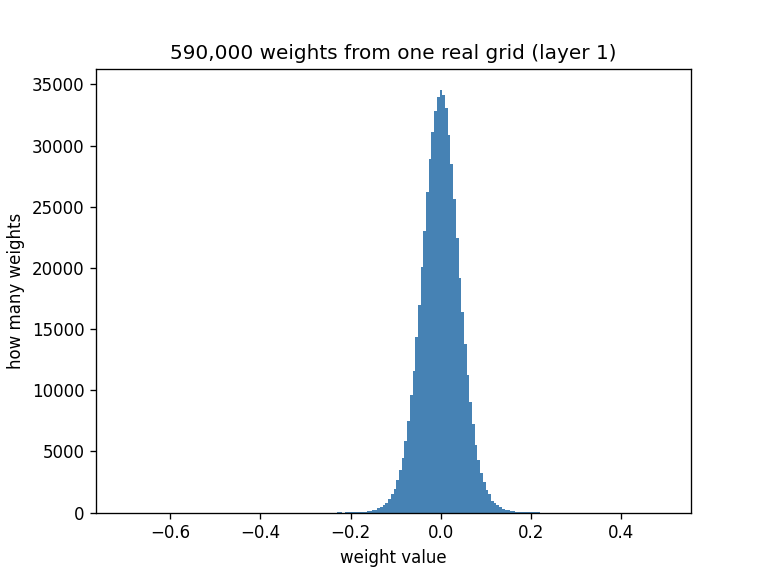

# tiny-quantization

Quantization, worked out by hand with small numbers. One idea per day.

I'm learning from MIT EfficientML [Lecture 5](https://www.youtube.com/watch?v=Qg_3N8pdK9s)
(Days 1-13) and [Lecture 6](https://www.youtube.com/watch?v=_sHTMuOQY5A) (Day 14 on).
This repo is my notes in code form, written for someone new to the topic.

## The story so far (1 minute)

A model is millions of decimal numbers (weights). Quantization stores each one
in fewer bits, so the model fits in less memory. The price is rounding error.

```
Days 1-3   Round weights onto evenly spaced buttons. Fewer bits = bigger
           steps = bigger errors. Small weights can vanish to 0.
Day 4      K-means: let the buttons move to where the weights are.
Days 5-7   Shift and stretch the buttons so they fit the weights,
           and real 0 always gets a button of its own.
Days 8-9   Why bother: a 7B model drops from 28 GB to 3.5 GB at 4 bits,
           and one neuron still gives nearly the same answer.
Day 10     Real weights crowd near 0, with a few far out at the edges.
           Evenly spaced buttons waste most of their places on empty edges.
Day 11     On one real grid, K-means cuts the error to about a quarter.
Day 12     On the whole model at 4 bits: linear breaks it (says 👍 to
           everything), and K-means flips nothing.
Day 14     Give each row of a grid its own buttons (per-channel).
           Linear at 4 bits goes from broken to 1 flip in 20.
```

**The big lesson:** with the same memory, *where* you put the buttons decides
whether the model works.

**To run the code:** Days 1-9 need only Python. For Days 10-14, run
`pip install -r requirements.txt` first. Every `test_*.py` file prints
PASS or FAIL for each check.

---

## Day 1: Linear quantization

**The problem.** A model stores each weight as a 32-bit decimal number.
That takes a lot of memory. Moving memory around is slow and costly.

**The idea.** Store each weight in only 8 bits instead.
8 bits give us 256 whole-number "slots" (-128 to 127). We use -127 to 127.
That's 4× less memory.

**The catch.** A weight like `0.23` is not a whole number. So which slot does it go into?

### Why we can't just round

Most weights are small, between -1 and 1. Rounding them squashes almost everything to 0:

```
weights :  0.31  -0.82   0.07  -0.45   0.66
rounded :  0     -1      0      0      1
```

The model loses nearly all its information.

### The fix: stretch, then round

Let's use a toy box with only 11 slots, from -5 to 5. Our weights are:

```
0.2   -0.5   0.4   0.1
```

**Step 1. Find the scale.** The biggest weight (ignoring the minus sign) is 0.5.
We want it to land on the top slot, 5. So each slot step is worth:

```
scale = 0.5 / 5 = 0.1

real :  0    0.1   0.2   0.3   0.4   0.5
slots:  0 ── 1 ── 2 ── 3 ── 4 ── 5
```

**Step 2. Put a weight into a slot.** Divide by the scale, then round.

```
0.23 / 0.1 = 2.3   →   round   →   slot 2
```

**Step 3. Get it back.** Multiply the slot by the scale.

```
slot 2 × 0.1 = 0.2
```

We put in `0.23` and got back `0.2`. We lost `0.03`. That loss is the **rounding error**.

### How bad can the error get?

Think of a lift that only stops at whole floors. You want to reach height 3.2.
You get out at the nearest floor, 3, and miss by 0.2.

The worst case is a target exactly halfway, like 3.5. You miss by 0.5, half a floor. Never more.

Same with slots. Between slot 2 (0.2) and slot 3 (0.3), the worst weight is `0.25`.
It loses `0.05`, which is **half a step**.

> **The error is never more than half a step.**
> Smaller steps mean smaller errors.

### The whole algorithm

```
scale     = biggest weight / top slot
slot      = round(weight / scale)
recovered = slot × scale
```

Real int8 is the same thing with top slot 127 instead of 5.

---

## Run it

No libraries needed, just Python 3.

```
python quantize.py         # see a round trip on 5 weights
python compare_bits.py     # compare 8, 4 and 2 bits
python zero_weights.py     # see which weights become zero
python kmeans_quantize.py  # let the slots move to the weights
python shift_quantize.py   # start the slots at the smallest value
python test_quantize.py    # run all the checks
python test_kmeans_quantize.py
python test_shift_quantize.py
```

Output of `python quantize.py`:

```
scale = 0.00646

original   slot   recovered   error
  0.3100     48      0.3099   0.0001
 -0.8200   -127     -0.8200   0.0000
  0.0700     11      0.0710   0.0010
 -0.4500    -70     -0.4520   0.0020
  0.6600    102      0.6586   0.0014
```

Every error stays under half a step (0.00323).

---

## Day 2: Fewer bits

8 bits worked well. What if we use 4 bits, or just 2? Less memory again. What does it cost?

### How many slots?

`n` bits give `2^n` slots. We split them around zero and skip the lone bottom slot,
so both sides mirror each other. The top slot is:

```
top slot = 2^(bits - 1) - 1

8 bits  →  127     slots -127 … 127
4 bits  →  7       slots   -7 … 7
2 bits  →  1       slots   -1 … 1
```

### Think of a staircase

The biggest weight is a platform. The top slot is the number of steps up to it.
The scale is the height of one step.

```
scale = biggest weight / top slot

4 bits: 7 steps            2 bits: 1 step

            ┌─ 0.82                   ┌─ 0.82
          ┌─┘                         │
        ┌─┘                           │
      ┌─┘                             │
    ┌─┘                               │
  ┌─┘                                 │
┌─┘                                   │
0                                     0

step = 0.82 / 7 = 0.117      step = 0.82 / 1 = 0.82
```

Fewer steps means taller steps. Every weight must stand on its nearest step.
From Day 1, the worst miss is half a step. So taller steps mean bigger misses.

### The result

Run `python compare_bits.py`:

```
bits   slots used     step    worst possible error
   8   -127 to 127   0.006   0.003
   4     -7 to 7     0.117   0.059
   2     -1 to 1     0.820   0.410

weight      8-bit     4-bit     2-bit
  0.31     0.310     0.351     0.000
 -0.82    -0.820    -0.820    -0.820
  0.07     0.071     0.117     0.000
 -0.45    -0.452    -0.469    -0.820
  0.66     0.659     0.703     0.820
```

At 8 bits, every weight barely moves. At 2 bits, every weight becomes one of only
three values: -0.82, 0 or 0.82. This is called **ternary** quantization.

### Why does this hurt a network?

A neuron multiplies inputs by weights and adds them up. Take two weights, 0.31 and -0.82,
with inputs 2 and 1:

```
true weights:   2 × 0.31  + 1 × (-0.82)  =  -0.20
8-bit weights:  2 × 0.310 + 1 × (-0.82)  =  -0.20
4-bit weights:  2 × 0.351 + 1 × (-0.82)  =  -0.12
2-bit weights:  2 × 0     + 1 × (-0.82)  =  -0.82
```

### Then why do quantized networks work at all?

Three reasons, in plain words:

1. **Errors cancel.** Rounding to the nearest step moves some weights up and some down.
   Like a diversified portfolio, 100 random errors add up to about 10× one error, not 100×.
2. **Layers reset.** Normalization layers rescale numbers after each layer,
   so a small extra gain can't compound layer after layer.
3. **The answer only needs to win.** If "cat" scores 0.70 and "dog" 0.20, small errors
   won't change the winner. Only close calls flip.

That's why 8 bits is nearly free, while 2 bits usually needs extra tricks.

---

## Day 3: Fewer bits can delete weights

Look again at the 2-bit column above. Two weights became exactly `0.000`. Why?

### The zero zone

A weight lands on slot 0 when it is less than half a step away from 0.
Take 0.31 at 2 bits, where one step is 0.82:

```
0.31 / 0.82 = 0.38   →   less than 0.5   →   slot 0
```

So every weight inside `-half a step … +half a step` vanishes.
Taller steps make a wider zone:

```
      zero zone at 4 bits:     ├┤          (-0.059 … 0.059)
      zero zone at 2 bits:  ├────────┤     (-0.410 … 0.410)
   ──────────────────────────0──────────────
```

### The result

Run `python zero_weights.py`:

```
bits    step   zero zone           weights turned to zero
   8   0.006   -0.003 to 0.003     0 of 5  []
   4   0.117   -0.059 to 0.059     0 of 5  []
   2   0.820   -0.410 to 0.410     2 of 5  [0.31, 0.07]
```

Note that -0.45 survives. It is 0.55 steps from zero, just past the halfway mark.

### Why it matters

A zero weight does nothing, so we can skip it. That's **pruning** (Lecture 3),
and here it happens for free. The flip side: if a small weight was important,
2 bits deletes it without asking.

---

## Day 4: K-means quantization

Linear slots sit at equal gaps, no matter where the weights are.
At 2 bits, that wastes slots and deletes small weights:

```
weights:   -0.82      -0.45        0.07   0.31        0.66
              ●          ●           ●     ●            ●
  ────────────┼──────────────────────┼──────────────────┼────
linear:     -0.82                    0                 0.82
```

**K-means lets the slots move to where the weights bunch up.**

### Ice cream carts on a beach

Weights are kids. Slots are ice cream carts. Repeat two rules:

```
Rule 1: each kid walks to the NEAREST cart.
Rule 2: each cart moves to the AVERAGE of its kids.
Stop when no kid switches carts.
```

Kids at 0, 4, 10, 16. Carts start at 0 and 3:

```
Round 1:  groups {0} {4, 10, 16}   →  carts move to 0 and 10
Round 2:  kid 4 switches to A      →  carts move to 2 and 13
Round 3:  nobody switches          →  stop
```

We repeat because moving a cart changes who is nearest.

### The result

Start from the linear slots and run `kmeans`:

```
weight    linear slot   error    k-means slot   error
-0.82       -0.82       0.00       -0.635       0.185
-0.45       -0.82       0.37       -0.635       0.185
 0.07        0          0.07        0.19        0.12
 0.31        0          0.31        0.19        0.12
 0.66        0.82       0.16        0.66        0.00
─────────────────────────────────────────────────────
worst error             0.37                    0.185
```

The worst error halves, and no weight vanishes.

Each weight now stores only a 2-bit label (0, 1 or 2). The real values live
once, in a short list called the **codebook**: `[-0.635, 0.19, 0.66]`.
For a million weights, that list costs almost nothing.

### Two things to know

- **It always stops.** Each rule can only shrink the total distance.
- **The start matters.** Carts starting at 5 and 16 get stuck at 4.67 and 16,
  a worse answer. Starting from the linear slots spreads the carts out evenly.

Try it: `python kmeans_quantize.py`, then `python test_kmeans_quantize.py`.

### A question to think about

K-means only ever takes small steps that make things a little better.
Like a hiker walking downhill in fog, it stops in the first valley it finds,
even if a deeper valley sits just over the next hill.

```
start [0, 3]    →  [2, 13]       total walk 10     (deeper valley)
start [5, 16]   →  [4.67, 16]    total walk 10.7   (stuck in a shallow one)
```

**You can't know the best start ahead of time. So how could you make
getting stuck less likely?** (Answer at the start of Day 5.)

---

## Day 5: Shift the staircase

**Answer to Day 4's question first.** Try several starts, and keep the one
with the smallest total walk. This is called **restarts**. Each try is fast
and independent, so they can even run at the same time.

### The problem: empty slots

So far, our slots sat around 0. That fits weights like `-0.82 … 0.66`.
But some numbers in a network never go near 0. Say the values are `8 … 14`.

With 3 bits we get 8 slots, so 7 steps. Starting the staircase at 0 means
climbing from 0 to 14:

```
START AT 0                       START AT THE SMALLEST VALUE (8)

14 ┤ ■                           14 ┤ ■
12 ┤ ■                              ┤ ■
10 ┤ ■                              ┤ ■
 8 ┤ ■                              ┤ ■
 6 ┤ □  ← no value                  ┤ ■
 4 ┤ □    lives here                ┤ ■
 2 ┤ □                              ┤ ■
 0 ┤ □                            8 ┤ ■

step = 14 ÷ 7 = 2                step = 6 ÷ 7 = 0.857
```

Half the slots are wasted on the left. **The fix: start the staircase at the
smallest value**, so every step lands where the values actually are.

### Two notes are all you need

For values `8 … 22` and 3 bits:

```
start = smallest value             = 8
step  = (biggest − smallest) ÷ 7   = 14 ÷ 7 = 2
```

(3 bits give 2 × 2 × 2 = 8 slots. 8 slots have 7 steps between them.)

```
slot:    0    1    2    3    4    5    6    7
value:   8   10   12   14   16   18   20   22
```

Going there and back:

```
value → slot:   round((value − start) ÷ step)     14 → (14 − 8) ÷ 2 = 3
slot → value:   start + step × slot               3  → 8 + 2 × 3    = 14
```

We store only the tiny slots, plus the two notes once. When the model runs,
slots turn back into values just before the math.

### The result

Values `8 … 14`, 3 bits, worst error over 601 values:

```
Day 1 method     ████████████████████████  2.33
Shift (today)    ████▌                     0.43
```

About 5× smaller, with the same 3 bits. The worst error is still half a step.

**One trap:** if every value is the same (`5, 5, 5`), the step is 0, and
dividing by it crashes. Every value sits on slot 0 then, so we use step 1.

Try it: `python shift_quantize.py`, then `python test_shift_quantize.py`.

### A note on the name

Textbooks call this *asymmetric quantization*. Instead of the start, they store
the **zero point**: the slot where real 0 lands. For values `-2 … 12` with
step 2, real 0 sits on slot 1. It's the same information, written another way.

> One can be smart about memory and computation with little tricks that
> seem obvious in hindsight but add a lot.

### A question to think about

Networks are full of exact zeros. Every negative value that goes through a
ReLU comes out as exactly 0. Now take values `-1 … 13` with 3 bits:

```
step = (13 − (−1)) ÷ 7 = 2

slot:    0    1    2    3    4    5    6    7
value:  -1    1    3    5    7    9   11   13
            ↑
        real 0 falls between two slots
```

No slot holds 0. So every 0 comes back as -1 or 1.

**Is that a problem, if the error is still only half a step? And how could
you move the staircase a tiny bit so that 0 lands exactly on a slot?**
(Day 6 answers this below.)

---

## Day 6: Give real 0 its own slot

Think of 8 boxes. The box numbers (slots) never change. Each box carries a
sticky note with a real value. `start` is the note on box 0. `step` is how much
each next note goes up.

With values `-1 … 13`, real 0 falls between box 0 and box 1. So every 0 comes
back as -1 or 1. Networks are full of exact zeros (ReLU, pruning, padding), so
that small error repeats millions of times.

**The fix:** nudge `start` a little so one box lands exactly on 0.

```
before:  box   0    1    2    3        after:  box   0    1    2    3
         note -1    1    3    5                note -2    0    2    4
                                                          ↑
                                                     zero point = 1
```

The box that holds real 0 is the **zero point**. To find it, count the steps
from `start` up to 0, and round to a whole box:

```
zero point = round(−start ÷ step)        start −6, step 2  →  3
slot       = round(value ÷ step) + zero point
value      = step × (slot − zero point)
```

**Two small traps:**

- Python's `round(0.5)` gives 0, not 1. We use our own `round_half_up`.
- The nudge can push the top value one box too high (13 → box 8, but 3 bits
  stop at box 7). We clamp it back. The top value then returns as 12, not 13.
  That's a fair trade, since zeros are far more common than 13s.

Try it: `python zero_point.py`, then `python test_zero_point.py`.

```
original   slot   recovered   error
   0.000      1       0.000   0.000    ← every 0 comes back exact
   4.000      3       4.000   0.000
  13.000      7      12.000   1.000
```

### A question to think about

Take values `8 … 22`. Real 0 isn't even in the range. The formula gives a zero
point of −4, a box that doesn't exist. **Is that a problem? Should every
range be stretched to include 0?**

(Day 7 answers this below.)

---

## Day 7: Always leave a box for 0

**Yes, stretch the range to include 0.** Even when your numbers have no zeros.

Why? Networks add zeros your data never had. Image models put a frame of
zeros around each picture, called **padding**, so the sliding window can
reach the edges.

If the range is `8 … 22`, there is no box for 0. Each padding 0 gets pushed
into the nearest box and comes back as **8**. The quiet frame becomes a loud
one:

```
what the network meant      range 8..22 (ignores 0)    range 0..22 (includes 0)
  0  0  0  0  0               8  8  8  8  8              0  0  0  0  0
  0  9 12 15  0               8 10 12 16  8              0  9 13 16  0
  0  8 20 22  0      →        8  8 20 22  8              0  9 19 22  0
  0 11 14 10  0               8 12 14 10  8              0 13 13  9  0
  0  0  0  0  0               8  8  8  8  8              0  0  0  0  0
```

**The trade:** stretching makes each step a bit taller, so the picture gets
slightly blurrier (right). Ignoring 0 ruins the frame (middle). A little blur
is far better than a wrong frame, so real tools like PyTorch stretch the range
to include 0.

The fix is two lines: `lowest = min(smallest value, 0)` and
`highest = max(biggest value, 0)`. See `get_start_and_step_with_zero` in
`zero_point.py`.

Try it: `python zero_point.py`, then `python test_zero_point.py`.

---

## Day 8: Why big models fit on your laptop

**Quantization shrinks the suitcase.** It keeps the same model and the same
weights, and it stores each one in fewer bits.

A model with 7 billion weights stores each weight at 32 bits, which is 4 bytes.
That adds up to 28 GB. A normal laptop has 16 GB of memory, so the model will
not even load.

At 8 bits, each weight takes 1 byte, and the whole model needs only 7 GB:

```
Laptop memory:   [████████████████]               16 GB
7B at 32-bit:    [████████████████████████████]   28 GB   too big
7B at  8-bit:    [███████]                         7 GB   fits
7B at  4-bit:    [███▌]                          3.5 GB   fits easily
```

**The trade:** each halving of the bits halves the memory. In return you get
the small rounding errors from Days 1–7. That is why tools like llama.cpp and
Ollama ship 4-bit models: a little blur buys a model that actually runs.

Some models are too big no matter what. A 70B model still needs 35 GB at
4 bits.

Try it: `python model_size.py`, then `python test_model_size.py`.

---

## Day 9: Does the shrunk model still answer right?

**Mostly, yes.** Each weight picks up a small rounding error, and those errors
add up in the answer. Some push up and some push down, so they often cancel.

Think of a store that rounds every price to the nearest dollar:

```
milk   $2.40 → $2   (−40¢)  ┐
bread  $3.60 → $4   (+40¢)  ┘ cancel
eggs   $4.70 → $5   (+30¢)    left over
total $10.70 → $11  (+30¢)
```

A neuron works like that bill. It multiplies each input by a weight and adds
them up. We shrink one neuron's 3 weights and compare its answer:

```
bits   answer   off by
full    1.440   -
   8    1.438   0.002   almost perfect
   4    1.476   0.036
   2    1.557   0.117   drifts about 8%
```

**The trade:** fewer bits means bigger errors in each weight, so the answer
drifts more. More weights don't fix this. The errors cancel, but so does the
answer, because weights are a mix of plus and minus. 8 bits stays accurate
because each error starts tiny.

Try it: `python neuron_check.py`, then `python test_neuron_check.py`.

---

## Day 10: Look inside a real model

Until now we used toy numbers. Today we download a real model from Hugging
Face and look at its weights.

**The model:** a tiny sentiment model (`distilbert-sst2`). It reads a
sentence and says 👍 or 👎. It has about 67M weights, so 67M × 4 bytes is
about 268 MB.

A model is like a music box. The code is the machine. The weights are the
pins on the drum, and they decide the song.

### What real weights look like

We plot one grid from layer 1: 768 × 768 = 589,824 weights.



```
Smallest weight:  -0.705
Largest weight:    0.496
Within +/-0.1:     97.5%   ← nearly everyone crowds near 0
Positive:          50.1%   ← half push up, half pull down
```

It's a tall, thin hill. A few rare weights stretch the range far out to the
edges.

### Why that hurts linear quantization

At 4 bits we get 16 buttons, spread evenly from -0.705 to 0.496.

```
scale      = 1.2 ÷ 15         = 0.08    (how tall each step is)
zero point = round(0.705 ÷ 0.08) = 9    (the button that means real 0)
button     = 9 + round(weight ÷ 0.08)
```

The crowd at ±0.1 is only 0.2 wide, so it gets about 2 to 3 buttons. It's
like a 16-floor hotel where 97.5% of guests share 3 floors.

Any weight within half a step of 0 (±0.04) lands on button 9 and comes back as 0:

```
8 bits:   4.6% of weights vanish to 0
4 bits:  66.5% vanish
2 bits:  almost all vanish
```

**The trade:** a few loud weights set the step size for everyone. Linear
spaces its steps evenly, so the quiet crowd gets rounded coarsely.

Try it: `python look_inside.py` (downloads 268 MB the first time), then
`python test_look_inside.py`.

---

## Day 11: K-means beats linear on a real layer

**The answer:** on the same 589,824 real weights, K-means cuts the error to
about a quarter of linear's, at every bit width. Not just at low bits.

Same number of buttons, two ways to place them:

```
Linear:   buttons evenly spaced, edge to edge
  ●──────●──────●──────●──────●──────●──────●
              [██ crowd ██]

K-means:  buttons (carts) walk to where the weights are
                ●  ●●●●●●●  ●
              [██ crowd ██]
```

### The score: mean absolute error

Take the size of each miss, ignore its sign, and average. Without the
`abs()`, a miss of +0.1 and a miss of −0.1 would cancel to a perfect 0.

### The result

The K-means carts start on the linear buttons, so the race starts as a tie.
Then the carts move.

```
bits   linear MAE   k-means MAE   k-means error is
  8      0.00118      0.00033       28% of linear
  4      0.01981      0.00413       21% of linear
  2      0.03380      0.01237       37% of linear

buttons inside the crowd (±0.1):
  8 bits:  linear  43 of 256   k-means 151 of 256
  4 bits:  linear   3 of 16    k-means  12 of 16
  2 bits:  linear   1 of 4     k-means   4 of 4
```

Even with 256 buttons, linear parks most of them in the empty edges. The
problem is the **shape** of the weights, not the number of bits.

### The catch

At 2 bits, all 4 carts move into the crowd (−0.07 to +0.07). So the rare big
weights get crushed: +0.496 comes back as +0.066. The average error drops,
but a few weights get badly hurt. Do those few matter? Day 12 will tell.

We use scikit-learn's `KMeans` because our Day 4 loops would be far too slow
for 590,000 weights. A test checks that it gives the same carts as our own
Day 4 code.

Try it: `pip install scikit-learn`, then `python race.py` (about a minute),
then `python test_race.py`.

---

## Day 12: Same memory, broken model or perfect model

**The answer:** we squeeze all 38 grids of the model and ask it 20 movie
reviews. At 4 bits, linear breaks the model. K-means flips nothing.

```
flips out of 20 reviews (vs the original model)
            8 bits   4 bits   2 bits
linear        0        10       10     ← stuck on 👍, as good as a coin
k-means       0         0        5     ← damaged, but still reading
```

### The broken thermometer

Linear at 4 bits answers 👍 to all 20 reviews, even *"Terrible script,
terrible acting, terrible everything."* Like a thermometer stuck on 25°C, it
looks right on some days but measures nothing. Our reviews are half 👍 and
half 👎, so it flips all 10 negative ones. A coin would do as well.

### Three choices that keep the test fair

```
1. Each grid gets its own buttons      (per-tensor quantization)
     the classifier is only -0.07..0.07; layer 6 ffn.lin2 is -3.19..1.09.
     One shared set of buttons would turn the whole classifier into 0.

2. Compare with the ORIGINAL model     (not with a human's answer)
     then every flip comes from the squeeze, nothing else.

3. Squeeze a fresh COPY each time      (the original is our "before" photo)
```

### Polling for speed

K-means on 43 million weights is slow. Like a pollster, we place each grid's
carts using a random 50,000 of its weights, then snap all of them to the
nearest cart. On the Day 11 grid, the poll's error is within 1% of asking
everyone, in under a second.

**The trade:** both methods use the same memory. Only the button placement
differs, and at 4 bits that's the difference between a broken model and a
perfect one.

Try it: `python whole_model.py` (about 2 minutes), then
`python test_whole_model.py`.

---

## Day 14: One outlier shouldn't blur the whole grid

**The answer:** give every row of a grid its own buttons. Linear at 4 bits
goes from "👍 to everything" to just 1 flip in 20, with the same 4 bits per
weight.

### Why it works: one zoom per row

Picture a school photo with one very tall student in row 3. To fit them in,
the photographer zooms out, and every face gets tiny. Fix: one photo per row.
Only row 3 gets zoomed out.

A grid works the same way. On Day 12, each grid had one scale, so a single
outlier stretched the range for all 589,824 weights. Now each row gets its
own scale and zero point.

```
per-tensor (one scale)          per-channel (one scale per row)
row 1  · · · · ·  blurry        row 1  ● ● ● ● ●  sharp
row 2  · · · · ·  blurry        row 2  ● ● ● ● ●  sharp
row 3  · · · ⬤ ·  outlier       row 3  · · · ⬤ ·  only this row pays
row 4  · · · · ·  blurry        row 4  ● ● ● ● ●  sharp
```

### Why rows? A layer is a panel of judges

Every judge reads the same 768 inputs, and each row is one judge's scoring
sheet. One judge's output is called a **channel**. Judges have different
habits (some score big, some gentle), so each one gets their own scale.

### The results

```
one grid (layer 0 q_lin), average error per weight
bits   per-tensor   per-channel
  8      0.00118      0.00031
  4      0.01981      0.00535     ← about 4x smaller
  2      0.03380      0.02476

whole model, linear: flips out of 20 reviews
               8 bits   4 bits   2 bits
per-tensor        0       10       10     ← Day 12: stuck on 👍
per-channel       0        1        6     ← today
```

At 2 bits, the 8 easy reviews all survive. The 6 flips are the tricky ones:
*"Not bad at all"* becomes 👎, and *"Oh great, another two hours of my life
gone"* becomes 👍. The squeezed model reads single words at face value and
loses "not", "but" and sarcasm. **Lesson: test squeezed models on hard
examples, not just easy ones.**

**The trade:** one extra scale per row. For `q_lin` at 4 bits, that's 768
scales (about 3 KB) on top of about 295 KB of weights, or about 1% more
memory. Rows that hold an outlier still suffer inside, which is tomorrow's
problem.

Try it: `python per_channel.py` (about 5 minutes), then
`python test_per_channel.py`.

---

## Day 15: Groups, and the hidden cost of scales

**The answer:** cut every row into small groups of 16 weights, and give each
group its own buttons. Linear at 4 bits now flips 0 reviews in 20, and 2 bits
flips just 1. But the scales cost real memory, so always count them.

### Why it works: the outlier only blurs its own group

On Day 14, row 3 had one outlier, so all 768 weights in row 3 got wide steps.
Now the outlier only spoils its own group of 16. The other 752 weights in the
row stay sharp.

```
per-channel (one scale per row)
row 3  [ · · · · · · · ⬤ · · · · · · · · · · · · · · · · · · · · · · · · · ]  all blurry

per-group (one scale per 16 weights)
row 3  [ · · · · · · · ⬤ · · · · · · · · ][ ● ● ● ● ● ● ● ● ● ● ● ● ● ● ● ● ]  ...
              only this group pays                    sharp
```

The code reuses the same Day 6 `squeeze()`. It just runs on each group
instead of each row.

### The results

```
flips out of 20         8 bits   4 bits   2 bits    extra bits per weight
per-tensor  (Day 12)       0       10       10        ~0
per-channel (Day 14)       0        1        6        0.04
per-group   (today)        0        0        1        2.00
```

At 2 bits, "Not bad at all" and the sarcastic review read correctly again.
The only flip left is *"My kids loved it, I fell asleep."* That one is mixed
even for a human.

### The catch: who pays for the scales?

Each group stores one 32-bit scale. Its 16 weights split that bill, like 16
friends sharing a $32 dinner:

```
bits per weight = own bits + 32 ÷ group size

per-channel 4-bit:   4 + 32 ÷ 768  ≈ 4.04 bits
per-group   2-bit:   2 + 32 ÷ 16   = 4    bits   ← really a 4-bit format!
group of 1:          4 + 32 ÷ 1    = 36   bits   ← worse than plain float32
```

So per-group 2-bit and per-channel 4-bit fill the same suitcase. Both flip 1
review. And on one real grid, per-channel 4-bit is actually closer to the
original (average error 0.0054 vs 0.0129).

**The trade:** smaller groups make each group sharper, but every group adds
a scale to store. **Lesson: when someone says "2-bit", ask "how many bits per
weight, including the scales?"**

Try it: `python per_group.py` (a few minutes), then `python test_per_group.py`.

### A question to think about

Groups clearly help, but a 32-bit scale per 16 weights is a big bill. You
can't make the groups bigger without losing the gain. What else could you
change to make the bill smaller?

---

## Coming next

Clipping (cut off the far edges on purpose) and why not always use K-means? Linear buttons follow a formula, so chips can
multiply whole numbers fast. K-means carts sit anywhere, so every weight
needs a lookup table first.

Later: integer-only math (multiply slots directly, without converting back).
